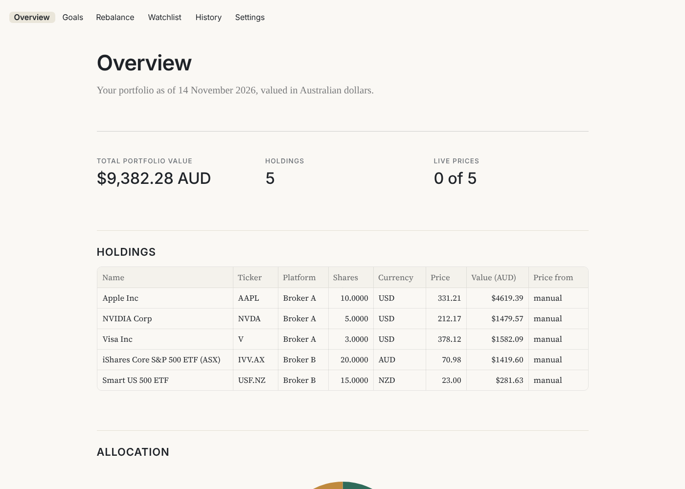
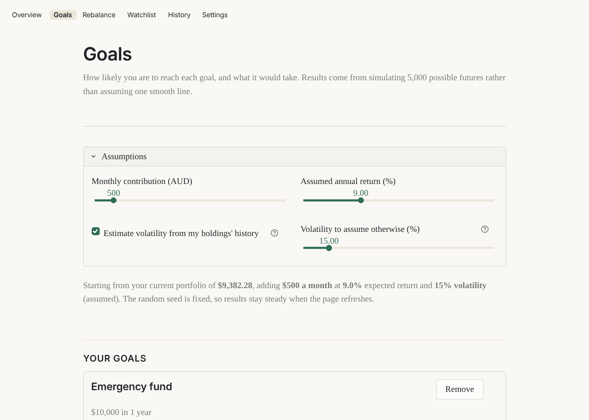
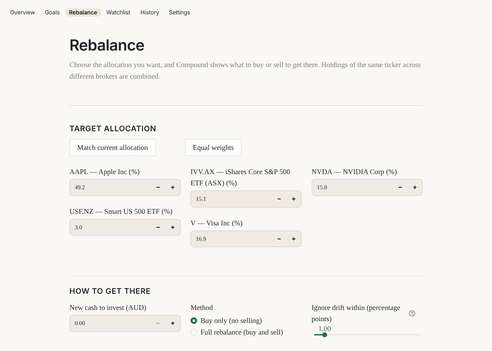

# Compound

A self-updating portfolio tracker, goal planner and rebalancing tool, built as
a personal project to track my own investments across brokers and currencies,
and designed generally enough that anyone can drop in their own holdings.

It started as a single-purpose calculator and grew into an analysis tool.
Instead of just showing a balance, it estimates **how likely you are to hit
your goals** and **what to buy next to stay on target**.

**[Try a live app demo](https://compound-cyu.streamlit.app)**

## Features

- **Live prices** via `yfinance`, cached for 30 seconds so the app doesn't
  hammer the API, with an optional hands-off auto-refresh timer
- **Multi-currency portfolio** (AUD/USD/NZD), consolidated into a single AUD
  total
- **Monte Carlo goal probabilities**: instead of one smooth projection at a
  fixed return, Compound simulates 5,000 possible futures and reports the **chance of
  reaching each goal**, plus a poor/typical/good range of outcomes and a fan
  chart. Volatility is estimated from about two years of your holdings' price
  history, or set manually.
- **Rebalancing suggestions**: set a target allocation and see exactly what
  to buy or sell. *Buy-only* mode steers new cash towards underweight holdings
  without selling anything; *full rebalance* mode moves everything to target.
  A tolerance band leaves near-target holdings alone.
- **Multiple custom goals** — name, target amount and timeframe are all yours
  to set.
- **"What would it take?"** — for each goal, solves for the monthly
  contribution needed at your assumed return, and the return needed at your
  current contribution.
- **Watchlist** for tickers you're tracking but don't own, with live price and
  day change.
- **History log** to compare your actual trajectory against the projection.
- **No login or database required**. Your data lives in the browser session while you
  use it. You can also download it as a JSON file (holdings, goals, watchlist and target
  weights) to pick up where you left off next time.
  

## Screenshot

Six pages, reached from the top navigation: Overview, Goals, Rebalance,
Watchlist, History and Settings. Screenshots use the made-up example data.





Body text is Times New Roman; headings, numbers and navigation use Montserrat.
Both fonts are set in `ui/theme.py` and the colours in `.streamlit/config.toml`.

## Getting started

```bash
git clone https://github.com/cyu0066/compound.git
cd compound
pip install -r requirements.txt
streamlit run app.py
```

Open the local URL Streamlit prints (usually `http://localhost:8501`). It loads
with made-up example data from `data/*.json` — edit or delete everything from
inside the app itself, no need to touch those files directly.

## How the Monte Carlo simulation works

A fixed-return projection says "you'll have $X", which hides the fact that
markets are bumpy. Compound instead simulates many possible futures. Each
month's growth is random, drawn from a lognormal distribution:

```
log(growth) ~ Normal((μ − σ²/2) / 12,  σ² / 12)
balance(t)  = balance(t−1) × growth + monthly contribution
```

where `μ` is your assumed annual return and `σ` is annual volatility. The
`−σ²/2` term makes the *average* simulated outcome match your assumed return,
while individual paths spread out around it (tested in
`tests/test_montecarlo.py`). The chance of reaching a goal is simply the share
of simulated paths that end at or above the target.

**Volatility** is estimated from roughly two years of daily prices for your
holdings, weighted by current portfolio value. This is an estimate with known
limits: it assumes constant weights, ignores currency moves, and the past may
not resemble the future. If history isn't available it falls back to a
manual slider (default 15%, roughly a broad stock index).

**Limits worth knowing.** The result is only as good as the return and
volatility you assume. Returns are treated as independent from month to month
and normally distributed in log terms, which understates crashes and
prolonged downturns. Treat the probabilities as a way to compare scenarios,
not as predictions.

## How the rebalancing works

Given current values and target weights, the trade for each holding is
`target weight × (portfolio + new cash) − current value`.

- **Full rebalance** applies those trades directly (sells fund the buys).
- **Buy only** never sells: it puts the new cash into underweight holdings in
  proportion to how far below target each one is, so the total spent equals
  the cash added.

Holdings of the same ticker across different brokers are combined. Suggestions
ignore capital gains tax and brokerage fees, which the app says plainly.

## Design decisions

- **No cost-basis tracking.** Many investors average in over time (dollar-cost
  averaging) across multiple purchases and brokers, which makes a single
  "cost basis" number misleading and fiddly to maintain. Compound focuses on
  where your portfolio *is* and where it's *heading*, rather than tax-style
  gain/loss accounting.
- **Logic separated from the UI.** Everything in `core/` has no Streamlit
  dependency, so it's independently testable and reusable (e.g. in a notebook
  or a future CLI).
- **Reproducible simulations.** The simulation uses a fixed random seed so
  numbers don't jump around every time the page refreshes.

## On persistence, and how this could become a real multi-user app

Streamlit apps don't have a database by default. Each visitor gets an
independent, in-memory session that disappears when the tab closes. For a
personal project that seemed the right trade-off rather than over-building, so:

- Data lives in `st.session_state` while you use the app.
- The Settings page's **Download my data** / **Upload my data** controls export
  everything to a JSON file and reload it next time, or on a different device.

For real multi-user accounts with server-side persistence, the natural next
step would be swapping the `st.session_state` reads/writes in `app.py` and `views/` for a
lightweight backend (SQLite for a single server, or Supabase/Postgres for a
hosted multi-user version) keyed on a login. That's a deliberate scope cut for
now, not an oversight.

## Project structure

```
compound/
├── app.py                    # Entry point: theme, shared state, prices, top navigation
├── views/                    # One file per page
│   ├── overview.py           # Totals, holdings, allocation, add/remove holdings
│   ├── goals.py              # Monte Carlo chances, what-it-takes, fan chart
│   ├── rebalance.py          # Target weights and suggested trades
│   ├── watchlist.py
│   ├── history.py
│   └── settings.py           # Prices, exchange rates, download/upload data
├── ui/
│   ├── theme.py              # Fonts, spacing, chart styling
│   └── state.py              # Session defaults and cross-page state
├── .streamlit/config.toml    # Colours and base font
├── core/
│   ├── models.py             # Holding, Goal, WatchlistItem dataclasses
│   ├── prices.py             # Live prices and price history, with caching
│   ├── calculator.py         # Currency conversion, valuation, fixed-return projections
│   ├── montecarlo.py         # Simulation, goal probabilities, volatility estimate
│   ├── rebalance.py          # Target weights and buy/sell plans
│   └── storage.py            # Loading defaults + JSON import/export
├── data/                     # Made-up example holdings, goals, watchlist; history log
├── tests/
│   ├── test_calculator.py    # Currency, projection and goal-solving maths
│   ├── test_montecarlo.py    # Simulation properties and volatility estimate
│   ├── test_rebalance.py     # Buy-only and full-rebalance behaviour
│   ├── test_storage.py       # JSON round-trips, including older files
│   └── test_app_smoke.py     # Runs every page headlessly; checks settings survive page changes
└── requirements.txt
```

## Running the tests

```bash
pip install pytest
pytest
```

The tests check properties as well as examples: with zero volatility the
simulation must equal the closed-form answer; with no contributions its average
must match the assumed return; a full rebalance must land exactly on target;
and buy-only mode must never sell and must spend exactly the cash added.

## The fixed-return maths

The "what would it take?" figures use monthly-compounded contributions:

```
FV = P(1 + r)ⁿ + C × [((1 + r)ⁿ − 1) / r]
```

where `P` is the current portfolio value, `C` the monthly contribution, `r` the
monthly return (annual ÷ 12) and `n` the number of months. "Required monthly
contribution" is this solved for `C`. "Required annual return" has no
closed-form solution (`r` sits inside both the exponent and the annuity
factor), so it's solved numerically by bisection.

## Roadmap

- [ ] Risk analytics: maximum drawdown, correlation between holdings, a
      concentration measure, and a comparison against an index fund
- [ ] Per-goal contribution and return assumptions instead of one shared setting
- [ ] Dividend tracking and reinvestment modelling
- [ ] Simulate returns by bootstrapping real historical returns instead of a
      normal distribution
- [ ] Price alerts when a watchlist ticker crosses a threshold
- [ ] A real backend (see "On persistence") for multi-user accounts
- [ ] Deploy to Streamlit Community Cloud for a shareable link

## Disclaimer

This is a personal tracking tool, not financial advice. Projections and
simulations depend entirely on the return and volatility you assume, real
markets can do much better or much worse than any simulation, and rebalancing
suggestions ignore tax and trading costs.
